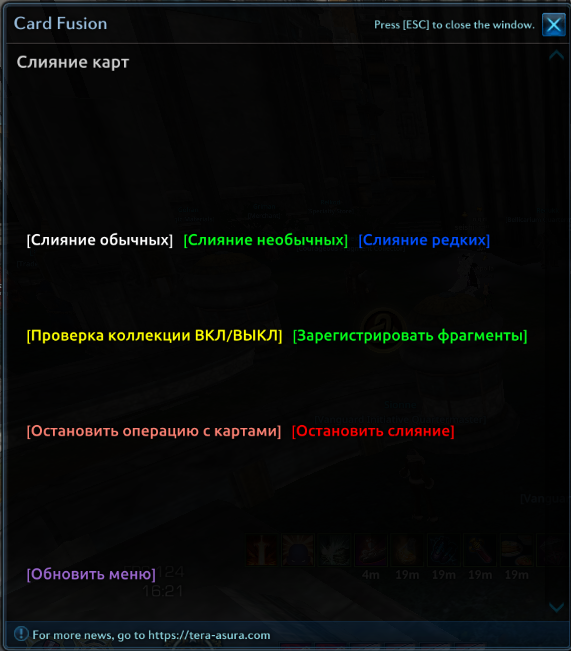
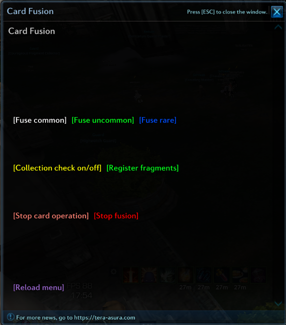

# Auto Card Fuse

## Commands

Enter commands in the Toolbox chat channel (`/8`).

Press **Ctrl+Alt+F6** by default to open the Card Fusion menu, or enter `cardfusion menu`. Set the hotkey in `config.json` or change it with `cardfusion hotkey Ctrl+Alt+F6`. The menu labels are in `menu.js` and `menu_ru.js` and include only this module's commands.

| Command | Action |
| --- | --- |
| `cardfusion menu` | Open the Card Fusion button menu |
| `cardfusion reloadmenu` | Reload menu.js/menu_ru.js and reopen the menu |
| `cardfusion hotkey` | Show the menu hotkey; add a key combination to change it |
| `fuse 1` | Fuse common cards |
| `fuse 2` | Fuse uncommon cards |
| `fuse 3` or `fuse` | Fuse rare cards |
| `fuse collection` | Protect unfinished card types from fusion. Toggles on or off and saves the state in `config.json`. |
| `fusestop` | Stop fusion and cancel any pending restart |
| `cardfusion register` | Register fragments up to 20 per card type |
| `cardfusion stop` | Stop the active card operation |

## How it works

Close the manual Random Fusion window before starting. The mod opens its own table on TERA Asura (protocol `376012`). It picks the largest eligible stacks of four distinct card types in your bag and pockets. You need four free inventory slots. Fusion skips card IDs `341034`, `340034`, `311068`, `310068`, `311027`, and `310027`.

When you enable `fuse collection`, the mod skips any card type you haven’t completed. That includes types you’ve never collected and types with fewer than 20 registered copies. Once a type reaches 20 registered copies, its spare fragments are eligible for fusion. Your collection data must load before fusion can start in this mode.

The check is **off by default**, so fusion can use fragments from unfinished card types. Run `fuse collection` again to turn the check off. Its state is saved in `config.json` and persists across character changes and module restarts.

The smallest stack sets the batch size. For stacks of 7, 5, 4, and 2, the mod runs up to two confirmed fusions before closing the table. Once the server confirms closure and inventory updates, the mod rescans and opens a fresh table if four eligible types remain. It stops on a manual stop, a server rejection, or an unconfirmed fusion.

## Menu screenshots

Russian interface:

English interface:

